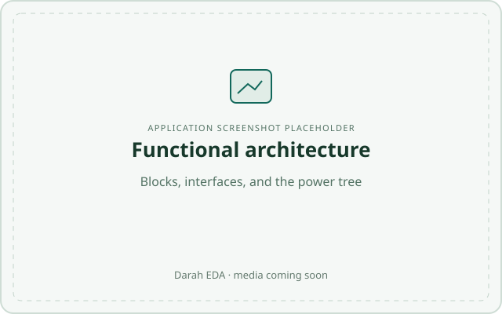
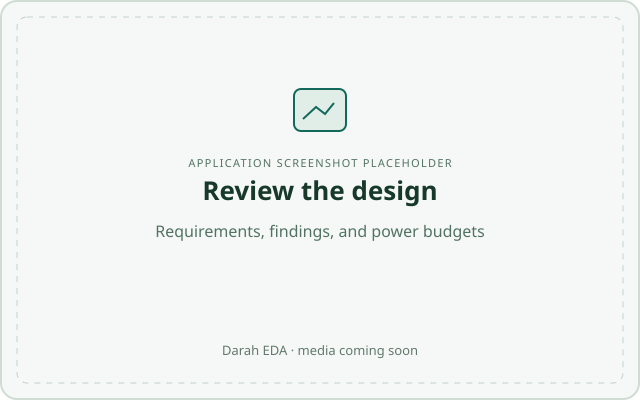

# Darah EDA

**Define electronics systems. Connect their interfaces. Review the engineering assumptions.**

Darah EDA is a local desktop workspace for planning electronics at the system level. Build a functional block diagram, describe power and signal interfaces, capture requirements, and review compatibility and power budgets before moving into detailed implementation.

[Download the latest release](https://github.com/citrineio/darah-eda/releases/latest) · [Installation](docs/installation.md) · [User guide](docs/usage.md) · [Report an issue](https://github.com/citrineio/darah-eda/issues/new/choose)

## See Darah in action

  
  

*Screen recording and application screenshots will be added here. These images are placeholders.*

## From system intent to a reviewable design

Electronics architecture spans more than a diagram. A source needs enough capacity for its loads; a converter connects two power domains; a sensor and controller need compatible interfaces; a requirement needs an allocation and evidence.

Darah brings those relationships into one editable model. The diagram, requirements, and reviews share the same project data, so changes can be assessed in context. Projects are stored locally in readable `.darah.toml` files.

## Features

| Area | What you can do |
| --- | --- |
| **Functional architecture** | Place and connect blocks for inputs, outputs, processing, power, and custom functions. Organize the design into systems and subsystems with boundary interfaces. |
| **Canvas editing** | Arrange blocks on a configurable grid, resize and align them, position ports, edit orthogonal wire routes, and use selection, panning, duplication, undo, and redo. |
| **Power architecture** | Model AC/DC sources, batteries, cascaded rails, converter topologies, efficiency and isolation assumptions, and operating-mode current overrides. Review rail budgets in current and nominal DC watts. |
| **Signals and interfaces** | Describe digital and analog characteristics, reuse shared interface contracts and port templates, and model signal-conversion channels. |
| **Connectors and protection** | Work with logical signal families and separate physical contact mappings. Capture series and shunt protection, declared ratings, fault coverage, and documented exceptions. |
| **Requirements** | Allocate requirements to the system, blocks, or ports. Record sources, criteria, verification methods, and evidence references, alongside connector mappings and control states. |
| **Design review** | Inspect failures, warnings, unresolved inputs, manual checks, and satisfied results. Review the whole design or a subsystem, with related findings highlighted on the canvas. |
| **Exports** | Share diagrams and requirements as PDF, PNG, or SVG; export requirements to CSV. Produce Design Review reports in PDF, HTML, CSV, or Markdown and detailed Power Review reports in PDF, HTML, or CSV. PDF and HTML reviews retain status colors and written verdicts. |

Darah evaluates the values and relationships declared in the model. Circuit simulation, PCB layout, signal-integrity analysis, compliance assessment, and physical verification remain separate engineering activities. A satisfied model check records the outcome within its stated scope.

## Get started

1. Follow the [installation guide](docs/installation.md) for **AppImage**, **Flatpak**, or **compiling from source**.
2. Open **Start guided monitor example** to explore a connected design, or choose **Start a blank project**.
3. Follow the [user guide](docs/usage.md) to define interfaces, review power budgets, capture requirements, and export your results.

Linux release downloads are available on the [releases page](https://github.com/citrineio/darah-eda/releases). Check the assets for the architecture you need.

**Need another package format or platform?** [Open an issue or feature request](https://github.com/citrineio/darah-eda/issues/new/choose). Include your operating system, CPU architecture, preferred format, and how you plan to install or update Darah.

## Documentation

- [Installation and source builds](docs/installation.md)
- [Using Darah](docs/usage.md)
- [Building and publishing releases](docs/publishing-updates.md)
- [Release notes](docs/releases/)

Searchable help is also available inside the application through **F1** or **Help → Help topics**.

## Feedback and contributions

[Report bugs, suggest features, or discuss improvements](https://github.com/citrineio/darah-eda/issues). For a bug report, include reproduction steps and **Help → About Darah EDA → Copy build info**. A small example project is useful when the issue concerns a calculation, connection, or review result; remove confidential information before sharing it.

For source contributions, build the project and run `cargo +stable test --locked`. Describe the engineering or usability problem your change addresses and include screenshots when changing the interface.

## License

Darah EDA is licensed under [GNU GPL v3.0 only](LICENSE).
